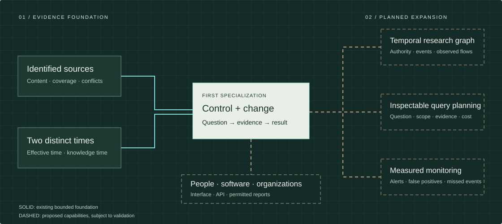

<p align="center"></p>

# EXIT · Blockchain Research & Monitoring

**Blockchain research. Grounded in evidence.**

EXIT is building a connected research infrastructure for understanding blockchain
activity: **what happened, who could act, what changed and what evidence supports
the conclusion**.

Our first specialization is control and change analysis. The larger direction is
a research environment connecting authority, events and observed fund relationships
across validated network coverage—usable by individuals, software and organizations.

[Use free research](https://api.exit-protocol.io/) · [Explore the research desk](https://exit-protocol.io/#start) · [Read the illustrated whitepaper](https://exit-protocol.io/WHITEPAPER-v0.6.html) · [Download PDF](https://exit-protocol.io/WHITEPAPER-v0.6.pdf) · [Whitepaper text & history](WHITEPAPER.md) · [Vision & mechanism](VISION.md) · [Visual roadmap](https://exit-protocol.io/ROADMAP.html) · [Roadmap record](ROADMAP.md)

## Why this matters

A transaction is a record. An investigation needs more: the conditions that made
an action possible, the evidence available at the time, competing explanations
and a path back to the sources. EXIT is designed to preserve those connections.

| From | Toward | How we intend to earn it |
|---|---|---|
| Isolated records | A temporal research graph | Typed relations with source identity, valid/known times and wrong-join controls. |
| An open question | An inspectable investigation plan | Explicit subject, network, time, coverage, evidence requirements and cost. |
| Unexplained signals | Measured monitoring and investigation | Declared event classes; held-out evaluation; false alerts and missed events. |
| A single report | Reusable organizational research | Versioned API, permission-scoped workflows and reproducible permitted outputs. |

These are development directions. Current delivery is stated separately below;
the system map is a conceptual illustration, not an operational network map.

## Start with the working foundation

The public [research desk](https://exit-protocol.io/#research) provides three
recorded authored case notes, source links, distinct event/knowledge times,
downloads and an offline edition. No wallet is required to inspect them.

The **30-day quota-limited free research console and API are open** at
[api.exit-protocol.io](https://api.exit-protocol.io/). Generate pseudonymous access
without an email, wallet, token or payment. One key covers live control reads for any Solana token mint (mint/freeze and supported Token-2022 authority fields, with one hop behind a multisig or program holder) and any Ethereum contract (proxy slots, the owner() getter as an observation, Safe owners and threshold, AccessControl default admins where readable, code presence), each at a finalized slot or block with its sources and limits; research records for questions that cannot be answered yet; a research graph over the key's own answers; Solana and Ethereum watches you check on request, with owned webhook receivers and hourly radar reads as a limited pilot; and historical
and change answers over three recorded Solana reference subjects. See the
[quick start, live examples and quotas](docs/API.md). The main-site research desk remains a recorded-case browser. The live API supports bounded control reads, not unrestricted wallet tracing or prose investigation.

EXIT's own records go into a public, append-only [evidence log](https://exit-protocol.io/log/), anchored on Solana once a day when it grows and checkable with a standalone verifier. The [Control Map](https://exit-protocol.io/control-map/) is a dated snapshot of which addresses hold the control roles of the largest tokens' Ethereum and Solana deployments.

[Connect scripts and agents](AGENT-TOOLS.md) with the public Python client, stdio MCP adapter and [OpenAPI description](openapi.json). No private research-engine code is included.

```sh
curl https://exit-protocol.io/solana-pyusd.json
```

The optional API Pass has a **private tested prototype**, not a deployed paid
service. Its completed-answer boundary keeps unanswered primary questions free
of credit charges. Bounded follow-up intake is not an executed research job.
Production serving integration, actual chain/wallet rehearsal and final security
acceptance remain open. See [current status](STATUS.md) and [service rights](TOKEN.md).

## A first release. A continuing engineering program.

The first free campaign opened **25 October 2026 at 12:38:20 UTC**, and ends
**24 November 2026 at 12:38:20 UTC**. It does not convert automatically to payment.
The same keys then continue in a quota-limited free tier without a fixed end date. Existing limits, revocations and counters carry over; there is no automatic payment or token requirement. See [current access terms](https://exit-protocol.io/terms.html).
**EXIT Protocol (EXITP)** has also been created on Solana. Its official mint is
[`5vPz2s8NtkasmVRDz5ySz27V1E8UdSpzqc9xN678jups`](https://studio.jup.ag/tokens/5vPz2s8NtkasmVRDz5ySz27V1E8UdSpzqc9xN678jups).
Token creation was reported before API activation; the actual sequence is preserved,
not backdated to the previous plan. Token-to-credit redemption is **not live**.

Development continues through conditional relative planning windows: research workflow
→ temporal graph → measured monitoring → organizational workflows. Bounded first parts of
the workflow, the graph and monitoring are live (see current status); the rest are future
capabilities, not claims delivered by creating a token or opening this first service.

New methods are compared with the existing baseline on the same tasks. Accuracy,
completion, reproducibility, latency and cost are measured separately. Methods
that add complexity without useful improvement are revised or stopped.

The verified token identity and present service-right limits are in [TOKEN.md](TOKEN.md).
Buying or holding EXITP does not activate a paid API Pass. Free service access is
independent of token ownership; payment never changes what the evidence supports.

## Official identity

EXIT Protocol (exit-protocol.io, github.com/ExitEvidenceLayer) is not affiliated with the
$EXIT token or EXIT HOUSE (Ethereum), with the EXIT Designer Token (BNB Chain) or with
exitprotocols.com (a forensic-accounting platform). Names and tickers never identify this
project; only the addresses and hashes published here do.

A second token named EXIT Protocol / EXITP (`3ev5LvQN8weDndULdFwNwEgfJueaoGYLdBPtnHhnjups`) was created
by the same launch wallet 28 seconds before the official mint, during the launch flow. It is not EXITP;
see [TOKEN.md](TOKEN.md).

### Verify the client files

Before running `exit_client.py` or `exit_mcp.py`, check that your copies match the files published here.

| File | SHA-256 |
|---|---|
| `exit_client.py` | `30c92ac0f84f504bd9d54b1ed9a146664044706bf3e7424286d5c2029222aa38` |
| `exit_mcp.py` | `bb72d79d3da7e7b9d4b236188035cb6648e37cd71f4c5c5973609efd53ffc378` |

On macOS or Linux, `shasum -a 256 exit_client.py exit_mcp.py` must print these values; on Windows PowerShell,
`Get-FileHash -Algorithm SHA256 exit_client.py, exit_mcp.py`. A copy with any other value is not the published file. When
the files change, these values change in the same commit.

## Project record

| Guide | Purpose |
|---|---|
| [Whitepaper](WHITEPAPER.md) | Problem, mechanisms, diagrams, mathematics, rights and growth. |
| [Vision](VISION.md) | The larger system, why each layer exists and how it is evaluated. |
| [Product](PRODUCT.md) | Useful questions, audiences and access paths. |
| [Technology](TECHNOLOGY.md) | Provenance, two-time reasoning and engineering invariants. |
| [Status](STATUS.md) | Publicly available, privately tested and open work. |
| [EXIT 3.0 scope](EXIT-3.0-SCOPE.md) | The accepted first-delivery scope, item by item, with status and limits. |
| [Roadmap](ROADMAP.md) | First-service criteria and conditional post-launch quarters. |
| [Token](TOKEN.md) | Verified official mint and planned paid-usage integration. |
| [Transparency](TRANSPARENCY.md) | Operating disclosures and privacy boundaries. |
| [Controls](CONTROLS.md) | EXIT's own keys and authorities, from facts anyone can check. |
| [Security](SECURITY.md) · [Support](SUPPORT.md) | Safe reporting and product enquiries. |
| [Contributing](CONTRIBUTING.md) | Reproducible public corrections, safe reports and contribution scope. |
| [API access](docs/API.md) · [Changelog](CHANGELOG.md) | Public revisions. |

This is the public documentation hub. Private engine history, credentials,
restricted raw evidence and sensitive operational details are not published here.
Public summaries do not grant redistribution rights over their underlying sources.

## License

Documentation in this repository is © EXIT Protocol and licensed under
[CC BY-ND 4.0](LICENSE) (Creative Commons Attribution-NoDerivatives 4.0 International).
The EXIT Protocol name and marks are not licensed. Public client wrappers are distributed under the same [CC BY-ND 4.0](LICENSE) terms; the research engine, datasets and
API service remain proprietary and are not part of this repository.

## 26 October — wider live research workflow

Inspect a Solana token mint or Ethereum contract, keep an unanswered query as an explicit research record, and re-check supported Solana authority changes on request. The free browser and [API](docs/API.md) share the same quota and evidence boundaries. [Agent tools](AGENT-TOOLS.md) expose the same workflow without a second research engine.

A bounded public-HTTPS acceptance passed: record lifecycle, watch lifecycle and cadence, Ethereum answer and byte-identical replay, exact usage and key revocation. Watches are on request, not a continuous alert service. No wallet, token purchase or email is required for the free campaign.


### Keyless evidence checks — 29 October 2026

Use `exit_history`, `exit_cite` and `exit_verify` through the existing stdio MCP server. Public inclusion and actual finalized-chain verification are separate outcomes; unavailable chain evidence cannot become `verified=true`. The keyless tools never forward research access keys. [Download the complete public source package and instructions](https://exit-protocol.io/tools/).
