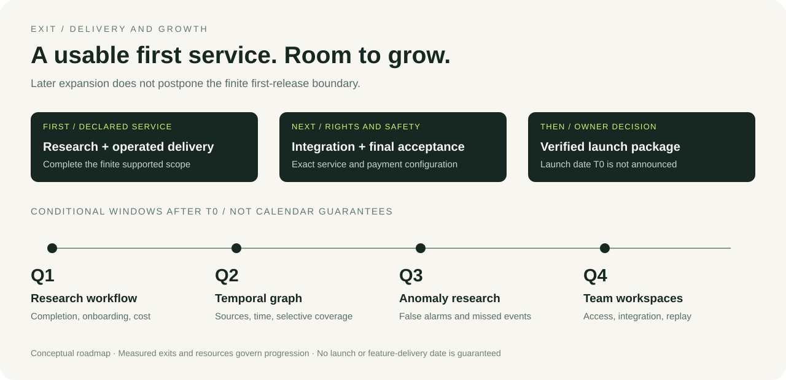

# A usable first release, followed by measured growth

**North Star:** evidence-based blockchain research and monitoring infrastructure.
**First specialization:** control and change analysis.

The first release has a finite scope. Subsequent expansion is designed to improve
the breadth, speed and reliability of supported investigations without hiding
what the evidence cannot establish.

## Before the launch decision

| Stage | Output | Exit condition |
|---|---|---|
| Supported research service | Declared control/history/change scope and understandable research experience. | Supported answers, evidence/time boundaries and limitations verified; required actual-host operation checks complete. |
| Service rights and integration | Bounded credits, access conditions, quotas, retries and recovery. | Accepted service rules match the implemented serving path; unanswered primary queries do not consume credit. |
| Payment and security acceptance | Exact token program/configuration and permitted chain/wallet rehearsal. | Receipt/auth/replay/recovery controls pass on the final configuration; separate security assessment complete. |
| Launch package | Final venue, mint settings, distribution, treasury, official identifiers and whitepaper. | Published descriptions match delivered rights; unresolved launch-blocking decisions are resolved. |
| Owner launch decision | A concrete verified package for the Owner's action. | Owner chooses whether to launch and performs the wallet approval, signature and creation action. |

Current delivery labels are in [STATUS.md](STATUS.md). Completion of the first
release does not require completion of the four growth quarters below.

## After launch: relative quarters

**T0** is the actual launch date, which is not announced. Q1–Q4 mean successive
three-month planning windows after T0. They are conditional targets, not calendar
guarantees. Each requires capacity, source access and evidence of usefulness.

| Window | Development direction | Measurable exit |
|---|---|---|
| Q1 · months 0–3 | Research workflow, clearer API onboarding, bounded follow-up research and service measurement. | A fixed supported-question bank shows improved completion or lower user effort/cost; unresolved work and billing remain visible. |
| Q2 · months 3–6 | Temporal research graph, source comparison and selective network/subject expansion. | Added subjects answer the same declared questions with provenance and time controls; added coverage is explicit. |
| Q3 · months 6–9 | Bounded market-integrity and anomaly research. | Predeclared event datasets report false alarms, missed events and uncertainty; causal or personal attribution requires separate evidence. |
| Q4 · months 9–12 | Organizational workspaces, integration and permission-scoped reproducible reports. | Access isolation, recovery, versioned integration and report reproduction pass defined acceptance tests. |

## Expansion rule

Compare a new method against the existing approach on the same question set.
Continue when it improves supported-answer accuracy, completion, speed or cost
enough to justify its operational burden. Revise or stop a method that does not.

Research planning, monitoring and graph analysis are product capabilities to be
earned with evidence. Neither a larger budget nor a token changes that standard.
