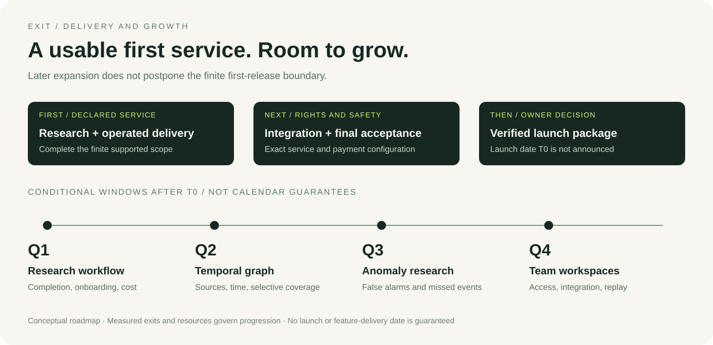

# A usable first release, followed by measured growth

**North Star:** evidence-based blockchain research and monitoring infrastructure.
**First specialization:** control and change analysis.

One master roadmap: the operated first release is followed by measured, continuous development toward evidence-based blockchain research and monitoring infrastructure.

The first release has a finite scope. Subsequent expansion is designed to improve
the breadth, speed and reliability of supported investigations without hiding
what the evidence cannot establish.



[Open the visual phase-by-phase roadmap](https://exit-protocol.io/ROADMAP.html).

## What comes first

Current chain state can be read at any time; a record anchored on a past day
cannot be produced later. Time-stamped history that cannot be back-filled is the
asset, so scheduled re-reading of control settings and change-only records,
anchored daily even without a change, come first. An anchor shows only that EXIT
held a record by its block time, not that the record is true, known earlier or
complete.

## Current engineering sequence · 4 November (T0 + 10 days)

Written on 4 November, with dated corrections to 10 November; corrected again, and the PLANNED lines added, on 11 November 2026.

```text
LIVE: recorded research + any-Solana-mint authority read + free API
  → LIVE: durable research records and explicit pull-change checks
  → LIVE: bounded Ethereum current-contract reader
  → LIVE: saved comparisons and answer-to-source navigation
  → LIVE: one-hop authority reads, research graph, Solana and Ethereum watches (bounded)
  → LIVE: public evidence log with a daily Solana anchor (tree size 370 on 3 November); Control Map snapshot (68 of 68 answered) and by-address view
  → LIVE (limited pilot): owned webhook receivers with hourly radar reads
  → LIVE: Python and in-browser verifiers; off-server sentinel (daily at 00:45 UTC; first scheduled run passed 29 October); answers bound to the log on request
  → LIVE: keyless history, cite and verify tools for agents (/tools/); EXIT's own control page (CONTROLS.md)
  → LIVE: the same keys continue in a quota-limited free tier after 24 November (continuation deployed 29 October)
  → LIVE: SPL Governance (Realms) configuration reader, one governance account per request; LayerZero pathway reader (delegate, libraries, verifier configuration), one OApp, endpoint id and direction per request (29 October)
  → LIVE: Control-Change Record format, setting names and checker, under an open license (no records in this format yet)
  → LIVE: public corrections list and error rate (CORRECTIONS.md), updated monthly
  → LIVE: on a day without new records, the daily job re-anchors the current root (31 October and 1 November)
  → LIVE: issuer-freeze read for one Ethereum address (USDT, USDC; PYUSD since 2 November) at one finalized block (1 November)
  → LIVE: proposals of one SPL Governance account (counts by state, open ones decoded); one OApp's peer for one remote endpoint id (1 November)
  → LIVE: Control Map daily re-read (standing job since 1 November; corrected 11 November 2026: since log specification 1.5 of 2 November every completed run records one record per row, an observation or a not-answered record, not only changes); reproducible case files for the BonkDAO and Kelp DAO cases (their records entered the log at the 2 November 00:30 UTC anchor, tree size 274)
  → LIVE: a nightly second-provider check of 12 Control Map rows (3 November 00:05 UTC); a daily off-host state copy with a restore drill (00:35 UTC)
  → LIVE: a provider refusal on the governance proposals route is recorded as PROVIDER_UNAVAILABLE, not as a method gap (3 November 13:50 UTC)
  → LIVE: the contract reader records a reverted owner() or issuer-getter call apart from a provider error, reads the issuer roles
      (master minter, pauser, blacklister, rescuer) for one reviewed issuer runtime pair (USDC) and gives every code it reads its
      designation, EIP-7702 included (schema /5, 4 November 01:35 UTC; the account types and EIP-7702 designations of the issuer role
      holders, multisig owners and AccessControl members are not read); from the 4 November 23:20 UTC re-read on, the nightly records
      of the 21 Control Map rows whose owner() reverts were expected to carry CALL_REVERTED (corrected 10 November: not shown in the
      public record, which names each record's evidence and result only by SHA-256; EXIT's record, added 11 November 2026: on the 4 and 9
      November 23:20 UTC re-reads all 21 answered owner() as CALL_REVERTED);
      an after-measurement on the fixed question bank was planned after that run
      (corrected 10 November: no result of it is shown in the public record; docs/Q1-RESULT.md reports only the 3 November baseline)
  → PLANNED (added 11 November 2026; latest dates, not guarantees: each item ships only after its own tests and review, and dates may move):
      by 13 November 2026: higher free limits, with a service-capacity view;
      by 14 November 2026: keyed chain-data providers, with the public endpoints as fallback;
      by 16 November 2026: a second-provider read of every Control Map row each night, shown on the daily page;
      by 17 November 2026: the Control Map page refreshed from the nightly reads;
      by 19 November 2026: change alerts within minutes, with more than one alert slot;
      by 21 November 2026: a public page to verify one record in the browser;
      by 22 November 2026: more control paths: Token-2022 interest-bearing, group/member and default-account-state settings and the
      transfer-hook program's authority;
      by 23 November 2026: beacon implementations and EIP-2535 diamond facets;
      by 25 November 2026: Safe pending transactions (depends on an external service)
  → NEXT: token-holder distribution facts in mint answers (waiting on provider access)
  → LATER: pre-registration, threshold notary, outside witnesses
  → LATER: paid service rights, chain/wallet rehearsal, separate security acceptance
```

Research records, on-request watches (Solana and Ethereum), Ethereum
current-contract reads and the research graph over a key's own answers are live in
the SAME free service, with the same access key and quotas. A bounded
public-HTTPS operator acceptance passed on 26 October for research records, Solana
watches and Ethereum reads; Ethereum watches and the research graph, live since 27
October, were not part of it. Since 27 October a limited
radar pilot reads pending-authority scopes once an hour for watches that have an owned webhook
receiver (one watch service-wide; EXIT's own test used that slot from 28 October, and on 11 November 2026 the slot was free); it is not continuous
monitoring, and pull checks remain the general monitoring scope. The script client
and MCP wrapper (server 1.3.1 in this repository since 10 November 01:04 UTC, hub
commit 84ed9680) cover the research routes of API version 2026-11-04.1 except
receiver registration; the account routes under
/early-access/ (challenge, enrollment, rotation, revocation, feedback), /v0/subjects,
/v0/corroboration and /v0/contract are not wrapped (AGENT-TOOLS.md lists the wrapped
tools). The client and MCP methods added for the routes newer than 2026-10-26.2 were checked against
a loopback stub of the API description, not against the live service with a key. Some of those routes were also called with a key on the live service by the question-bank run of 3 November 2026, before the 6 November Ethereum provider release: freeze, governance, LayerZero pathway and peer, graph, compare, evidence view and log binding each answered 200 at least once (docs/q1-result-20261103T000505Z.json), and the proposals route answered 503. Contract-watch creation and the webhook routes were not called in that run.

Public, with no key: the evidence log, a standalone verifier, keyless cite tools
and a browser check running code served by EXIT's site. The daily sentinel, which
re-runs the verifier, runs on GitHub Actions outside EXIT's server but is
controlled by EXIT. The Control Map snapshot answers 68 of 68 deployments (two of
them from a second read on 28 October). The first two private records, radar
events, were admitted at tree size 204 on 29 October. The first-year graph, planning and anomaly
program below remains a measured growth direction.

## Readers the cases showed are missing

| Reader | Case note (28 October) | Exit / stop |
|---|---|---|
| LayerZero OApp delegate and per-path DVN settings (verifiers, confirmations, library default) | Kelp DAO rsETH: one required verifier on the released path for about 381 days; a delegate outside the owner Safe for 235 days. | Reproduces the case's settings at the stated blocks; otherwise revise or stop. |
| SPL Governance (Realms) rules (threshold, wait, veto, voting times, who may propose) and new proposals | BonkDAO: 1% threshold, zero wait, community veto disabled for years; the deciding vote came from a wallet first funded the day before. | Reproduces the case's values and agrees with the program's logs; otherwise revise or stop. |

Both readers' configuration parts are live since 29 October: one governance account
and its realm per request; one OApp, remote endpoint id and direction per request
(delegate, send or receive library, raw and effective verifier configuration).
Proposals (open ones decoded, history counted by state) and peers (one eid per request) are read since 1 November.

A reader records configuration and changes, not why a setting was chosen, who
holds a key, or that a loss could have been prevented.

## Evidence discipline additions

Planned unless marked LIVE.

- **Control-Change Record (format LIVE, 29 October):** one change per record: chain,
  subject, setting, old and new value, bracketing reads or transaction, known_at,
  evidence hashes; it enters the log as an ordinary record (CONTROL-CHANGE-RECORD.md).
- **Pre-registration:** salted hashes of labels, thresholds and held-out windows
  enter the log before a run (a new log record kind); a hidden commitment does not
  by itself show that no other set was committed.
- **Public error rate (LIVE, 29 October):** corrections counted against records, map
  rows and case notes published; unfound errors are not counted (CORRECTIONS.md).
- **Reproducible case files:** every read, provider, slot or block, raw-reply hash
  and a re-read script; past-state reads need archive access. The BonkDAO and Kelp
  DAO case files entered the log at the 2 November 00:30 UTC anchor (tree size 274).
- **Keyless cite tools (LIVE, 29 October):** read-only history, cite and verify
  tools for a public record, with its proof and anchor check (/tools/).
- **EXIT's own control page (LIVE, 29 October):** public facts on the EXITP mint,
  notary keys, sentinel job and DNS record; not who holds a key (CONTROLS.md).

## First service and token sequence

| Stage | Output | Exit condition |
|---|---|---|
| Supported research service | Finite control/history/change scope. | Source/time boundaries and required operating results verified; historical operating checks closed before the free service opened. |
| 30-day free API opening | Bounded access, quotas, retries, revocation and recovery; no wallet/payment. | Corrected serving layer accepted, actual public access verified and dates/limits published. Opened 25 October 2026 at 12:38:20 UTC; the initial period ends 24 November at the same UTC time. Continuation deployed 29 October: the same keys then remain valid under the existing quota and lifetime caps, with no fixed end date or automatic payment. |
| Token creation | EXITP created on Jupiter Studio / Meteora DBC, Solana. | Created before API activation; official identity read back and published in TOKEN.md. Future financial and signing actions stay with the project's key holder. |
| Later paid API Pass | Exact usage right, commercial terms and receipt-to-credit integration. | Actual final-configuration chain/wallet rehearsal plus separate money/access security and operational acceptance. No automatic paid conversion. |

Current delivery labels are in [STATUS.md](STATUS.md). Completion of the first
release does not require completion of the four growth quarters below.

The roadmap stages and the whitepaper describe the same direction. Document version numbers identify revisions, not competing product plans. Whitepaper 0.7 aligns the delivery snapshot as of 5 November; subsequent releases remain dated in STATUS.md and CHANGELOG.md.

## After launch: relative quarters

**T0** is 25 October 2026: EXITP was created at 12:14:57 UTC and free service
opened at 12:38:20 UTC. Q1–Q4 are conditional growth windows after this actual
launch date, not prerequisites retroactively imposed on the first release. Q1–Q4 mean successive
three-month planning windows after T0. They are conditional targets, not calendar
guarantees. Each requires capacity, source access and evidence of usefulness.

| Window | Development direction | Measurable exit |
|---|---|---|
| Q1 · months 1–3 | Research workflow, clearer API onboarding, bounded follow-up research and service measurement; change-only re-reads, the two readers. | A fixed supported-question bank shows improved completion or lower user effort/cost; unresolved work and billing remain visible. |
| Q2 · months 4–6 | Temporal research graph, source comparison and selective network/subject expansion; reproducible case files, public error rate. | Added subjects answer the same declared questions with provenance and time controls; added coverage is explicit. |
| Q3 · months 7–9 | Bounded control-setting anomaly research: a setting lowered, a deciding vote from a new wallet, a delegate changed. Trading and price patterns stay a separate later direction. | Labels pre-registered in the log; predeclared event datasets report false alarms, missed events and uncertainty; causal or personal attribution requires separate evidence. |
| Q4 · months 10–12 | Organizational workspaces, integration and permission-scoped reproducible reports; threshold notary, outside witnesses. | Access isolation, recovery, versioned integration and report reproduction pass defined acceptance tests; anchors verify under a published key threshold. |

## Expansion rule

Compare a new method against the existing approach on the same question set.
Continue when it improves supported-answer accuracy, completion, speed or cost
enough to justify its operational burden. Revise or stop a method that does not.
Once pre-registration exists (LATER above), thresholds will be pre-registered;
corrections already count toward the public error rate (CORRECTIONS.md, since 29 October).

Research planning, monitoring and graph analysis are product capabilities to be
earned with evidence. Neither a larger budget nor a token changes that standard.

Not in this plan: trading or manipulation verdicts, person attribution,
all-network coverage, or paid service before its own acceptance.

## Long-term direction beyond these planning windows

Build a continuously operated research infrastructure connecting validated
multi-network authority, event and observed fund relations to inspectable query
plans, measured monitoring and machine-checkable permitted outputs. Stronger
formal or cryptographic methods require their own bounded task, assumptions,
baseline comparison and benefit. This is a direction, not a dated delivery claim.

Read the [illustrated whitepaper](https://exit-protocol.io/WHITEPAPER-v0.7.html)
and [vision/mechanism guide](VISION.md) for the larger system.


## Document alignment · 5 November 2026

One master direction: Evidence-based blockchain research and monitoring infrastructure. Solana first; control and change analysis is the first specialization. The updated [whitepaper 0.7](https://exit-protocol.io/WHITEPAPER-v0.7.html) explains the same program; [DOCS.md](DOCS.md) distinguishes the method, plan and dated delivery state. The shared [DELIVERY.json](DELIVERY.json) snapshot names live, pilot and prototype boundaries. Broader graphs, general question planning and paid redemption must not be inferred from a diagram or token ownership.
