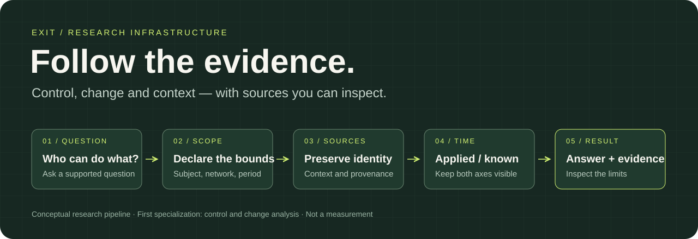

# How EXIT builds an inspectable result

EXIT's first specialization turns a supported control question into a structured
investigation. The method is designed to preserve the route from a conclusion to
its evidence instead of collapsing uncertainty into an unexplained label.



## 1. Declare the question

Represent an investigation by the subject, network, question type, valid-time
boundary and knowledge-time boundary. The supported question is fixed before its
answer is judged; scope is not silently narrowed after evidence is missing.

## 2. Preserve source identity

Evidence records carry content identity and acquisition context. Normalized or
derived observations retain their relationship to source material. A provider
response, a normalized record and an inference are separate objects.

A content digest helps detect changed bytes. It does not independently prove that
the source was truthful, that the search was complete or that an author signed it.

## 3. Separate two kinds of time

Let **V** be the time a fact applied on-chain and **K** the time at which it became
available to the research system. A historical answer must satisfy both its
declared event-time and knowledge-time constraints.

```text
An event applies at V1.
The evidence becomes known at K2.

A query evaluated with knowledge before K2 cannot use that evidence.
Learning it later must not rewrite what could have been known earlier.
```

Corrections and later knowledge are retained as history, rather than replacing an
earlier record without explanation.

## 4. Resolve control without inventing identity

The engine distinguishes an authority account, program-defined execution rules,
multisig membership and real-world principal attribution. A signer is not
automatically the authority holder. A public address alone does not identify a
person or organization.

Observed authority absence, unavailable evidence and an unsupported mechanism are
also different states. Missing observation is never silently promoted into safety.

## 5. Return the answer and its boundaries

A useful result combines:

```text
R = (question, declared scope, sources, valid time, known time, answer, limits)
```

Contradictory sources, unobserved interval starts and incomplete event windows
remain inspectable. A list of observed events is not a guarantee that every event
in the interval was fetched.

## 6. Make reproduction and billing explicit

Where data access and sharing permit, exact query/evidence/engine identities enable
a receiver to replay a declared result. Reproduction checks that procedure and
material; it is not universal proof of blockchain truth.

Commerce remains outside the evidence store. Payment must never change a conclusion,
its confidence, its source identity or whether an observation is disclosed.

The private API Pass prototype is tested against these key properties:

| Property | Required behavior |
|---|---|
| Receipt uniqueness | A chain receipt grants service credit at most once across accounts. |
| Request isolation | One account cannot occupy another account's request identifier. |
| Safe retries | Repeating delivered work does not repeat its charge. |
| Answer-dependent settlement | Transport success alone does not charge an unanswered question. |
| Recovery integrity | A trusted current checkpoint prevents an older restored ledger from reviving spent credit. |
| Evidence independence | Permitted evidence responses stay unchanged by the payment method. |

These are bounded engineering properties and local test results. Actual chain,
wallet, deployment and recovery acceptance require their own evidence.

## Quality strategy

EXIT uses deterministic tests, adversarial counterexamples, replay, concurrency and
fault tests, schema checks and selected mutations of critical guards. Model-generated
answers can be test inputs; model agreement is not ground truth or independent
security acceptance. A test result is tied to its exact tested version.

## Continuing research

The growth direction connects authority, events and funding relationships across
time in a research graph. Inspectable question planning, measured monitoring,
source comparison and organizational workflows extend this foundation when they
improve supported-answer quality, completion or cost. See [roadmap](ROADMAP.md).

## The wider research infrastructure

The current foundation extends toward a temporal graph, inspectable planning and
measured monitoring. See [the mechanism map](VISION.md) and [whitepaper](WHITEPAPER.md).
Dashed extensions in the public diagrams are planned capabilities, not deployed services.
